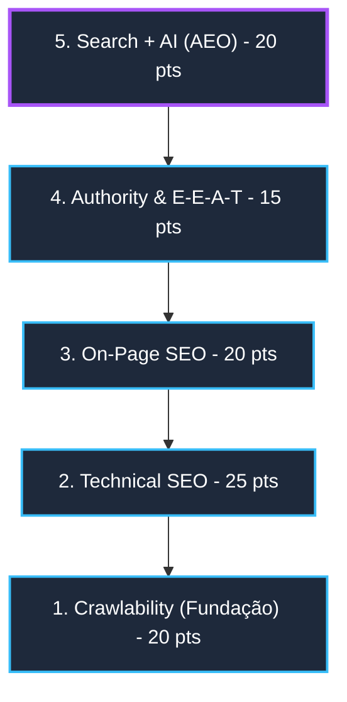

# Skill: SEO & AEO Technical Auditor (Search + Answer Engine Optimization)

Esta skill define o framework canônico de auditoria, pontuação e otimização para mecanismos de busca tradicionais (Google, Bing) e **mecanismos de resposta baseados em IA** (ChatGPT, Gemini, Perplexity, Copilot, Claude).

---

## 1. 🧠 Filosofia Central & Equação de Valor

> **SEO não é apenas colocar palavras-chave na página.**  
> O objetivo central é responder com máxima confiança à pergunta do buscador e das IAs:  
> **"Esta página é a resposta mais precisa, autoritativa e acessível para esta intenção de busca?"**

### A Equação de Ranqueamento & Citação:
$$\text{Score SEO/AEO} = \text{Relevância} \times \text{Qualidade} \times \text{Autoridade (E-E-A-T)} \times \text{Experiência (UX)} \times \text{Acessibilidade Técnica}$$

---

## 2. 🏛️ As 5 Camadas Arquiteturais & 20 Configurações Essenciais

O framework é estruturado em **5 camadas**, cada uma contendo configurações críticas com pesos específicos:



### Tabela Mestra das 20 Configurações

| # | Camada | Configuração | Requisito Técnico Estrito | Impacto | Peso (Pts) |
| :-: | :--- | :--- | :--- | :-: | :-: |
| **1** | **Crawlability** | **Robots.txt** | Permitir bots legítimos (`Googlebot`, `GPTBot`, `PerplexityBot`), bloquear rotas privadas/lixo e linkar sitemap. | 🔴 Alto | 4.0 |
| **2** | **Crawlability** | **XML Sitemap** | Sitemap dinâmico, atualizado, limpo (apenas URLs 200 OK, canônicas e sem noindex). | 🔴 Alto | 4.0 |
| **3** | **Crawlability** | **Canonical (`rel=canonical`)** | Auto-canônica correta em cada página; evita duplicação de query params/tracking. | 🔴 Alto | 4.0 |
| **4** | **Crawlability** | **HTTPS & SSL** | Certificado TLS válido, HSTS ativo e redirecionamento consistente 301 de HTTP → HTTPS. | 🔴 Alto | 4.0 |
| **5** | **Crawlability** | **URLs & Redirects** | URLs curtas, kebab-case, semânticas, sem parâmetros de estado; zero redirects em loop ou páginas órfãs. | 🔴 Alto | 4.0 |
| **6** | **Technical SEO** | **Core Web Vitals** | LCP ≤ 2.5s, INP ≤ 200ms, CLS ≤ 0.1 (dados reais / field data ou lab Lighthouse). | 🔴 Alto | 6.0 |
| **7** | **Technical SEO** | **Performance & Cache** | TTFB < 600ms, compressão Brotli/Gzip, Cache-Control imutável para assets estáticos, CDN edge. | 🔴 Alto | 5.0 |
| **8** | **Technical SEO** | **Mobile-First** | Viewport responsivo configurado, sem overflow horizontal, touch targets adequados (≥48px). | 🔴 Alto | 5.0 |
| **9** | **Technical SEO** | **HTML Semântico** | Uso adequado de `<main>`, `<article>`, `<section>`, `<nav>`, `<header>`, `<footer>`, evitando *div soup*. | 🟠 Alto | 4.0 |
| **10** | **Technical SEO** | **Otimização de Imagens** | Formatos modernos (WebP/AVIF), `srcset` responsivo, `alt` descritivo, dimensões explícitas e lazy-loading nativo. | 🟠 Médio | 5.0 |
| **11** | **On-Page SEO** | **Title Tag** | `<title>` único por página (50-60 caracteres), incluindo entidade principal + promessa/marca. | 🔴 Alto | 5.0 |
| **12** | **On-Page SEO** | **Meta Description** | Descrição persuasiva (120-155 caracteres) com call-to-action e resposta à intenção de busca. | 🟠 Médio | 3.0 |
| **13** | **On-Page SEO** | **Tag H1** | Exatamente um H1 por página, alinhado ao tema central e à intenção de busca principal. | 🔴 Alto | 4.0 |
| **14** | **On-Page SEO** | **Hierarquia H2/H3** | Estrutura de tópicos lógica em árvore; perguntas frequentes e subtópicos bem delimitados. | 🟠 Alto | 4.0 |
| **15** | **On-Page SEO** | **Links Internos** | Arquitetura de silos/tópicos (topic clusters) distribuindo PageRank com anchor texts semânticos. | 🔴 Alto | 4.0 |
| **16** | **Authority** | **Sinais E-E-A-T** | Páginas "Sobre", "Contato", "Termos/Privacidade", bio de autores com credenciais e experiência comprovada. | 🔴 Muito alto | 5.0 |
| **17** | **Authority** | **Backlinks & Menções** | Links de domínios com autoridade no nicho, menções não-linkadas e consistência NAP (Name, Address, Phone). | 🔴 Muito alto | 5.0 |
| **18** | **Authority** | **Google Search Console** | Propriedade verificada via DNS, sitemaps processados com sucesso e 0 erros de cobertura/indexação. | 🔴 Alto | 5.0 |
| **19** | **Search + AI** | **Schema.org / JSON-LD** | Marcações ricas (`Organization`, `LocalBusiness`, `Product`, `Article`, `FAQPage`, `BreadcrumbList`). | 🔴 Alto | 10.0 |
| **20** | **Search + AI** | **Citabilidade para LLMs** | Parágrafos com respostas diretas (bloco invertido), definições ontológicas claras, fontes citáveis e dados numéricos explícitos. | 🔴 Emergente | 10.0 |

---

## 3. 📊 Matriz de Pontuação: "SEO & AEO Technical Score" (0–100)

O **SEO Technical Score** consolidado avalia o domínio em escala centesimal:

$$\text{Score Total} = \sum_{i=1}^{20} \text{Pontos Configuração}_i$$

### Faixas de Classificação:
*   🟢 **90 – 100 | Classe Elite**: Pronto para topo do Google e alta taxa de citação em ChatGPT/Gemini/Perplexity.
*   🟡 **75 – 89 | Otimizado**: Estrutura sólida, pequenos ajustes de performance, E-E-A-T ou JSON-LD pendentes.
*   🟠 **50 – 74 | Alerta Moderado**: Gargalos técnicos ou on-page limitando o potencial de indexação e autoridade.
*   🔴 **00 – 49 | Crítico**: Bloqueios severos de rastreamento, renderização lenta ou ausência de dados estruturados.

---

## 4. 🔬 Protocolo de Auditoria e Comandos de Diagnóstico

### A. Validação de Crawlability & Headers (via CLI)
```bash
# 1. Verificar Headers HTTP, SSL e Redirecionamento Canônico
curl -ILs "https://exemplo.com" | grep -E "HTTP/|location:|strict-transport-security|cf-cache-status"

# 2. Inspecionar Robots.txt e regras de bots de IA
curl -s "https://exemplo.com/robots.txt"

# 3. Testar disponibilidade e formato do Sitemap XML
curl -s "https://exemplo.com/sitemap.xml" | head -n 25
```

### B. Validação On-Page & Schema.org
```bash
# Inspecionar tags essenciais de SEO On-Page e JSON-LD
curl -s "https://exemplo.com" | grep -iE "<title|<meta name=\"description\"|<h1|rel=\"canonical\"|application/ld\+json"
```

### C. Checklist de Verificação para AEO (Answer Engine Optimization)
1. **Bloco de Resposta Imediata**: As primeiras 2-3 frases após um H2 respondem diretamente à pergunta?
2. **Entidades Nomeadas**: A organização, produto ou serviço é definido como entidade inequívoca?
3. **Validação JSON-LD**: Os schemas passam sem erros no Schema Validator (`validator.schema.org`)?
4. **Permissões de IA no Robots.txt**: `GPTBot`, `PerplexityBot`, `ClaudeBot` e `Google-Extended` estão autorizados para páginas públicas?

---

## 5. 📋 Template do Relatório Canônico de Auditoria

Ao realizar a auditoria de um projeto ou gerar um diagnóstico para cliente, gerar o relatório no seguinte padrão:

```markdown
# Relatório de Diagnóstico SEO & AEO Technical Score

- **Domínio**: `https://dominio.com`
- **Data da Auditoria**: YYYY-MM-DD
- **Score Geral**: [XX/100] (🟢 / 🟡 / 🟠 / 🔴)

## Resumo por Camada
1. **Crawlability**: [XX/20] pts
2. **Technical SEO**: [XX/25] pts
3. **On-Page SEO**: [XX/20] pts
4. **Authority & E-E-A-T**: [XX/15] pts
5. **Search + AI (AEO)**: [XX/20] pts

---

## Plano de Ação & Remediação (Matriz de Prioridade)

### 🚨 P0 — Bloqueadores Críticos (Execução Imediata)
- [ ] Correção de canonical ou robots.txt bloqueando rastreamento
- [ ] Correção de certificado SSL ou loops de redirect

### ⚡ P1 — Alto Impacto (Curto Prazo - 7 dias)
- [ ] Implementação de Schemas JSON-LD (`Organization`, `FAQPage`, `Article`)
- [ ] Otimização de Core Web Vitals (LCP < 2.5s) e compressão de imagens
- [ ] Ajuste de Title tags e H1 únicos por página

### 📈 P2 — Otimização Contínua & AEO (Médio Prazo)
- [ ] Estruturação de respostas diretas para citação em ChatGPT/Gemini/Perplexity
- [ ] Construção de Topic Clusters e reforço de bios de autores (E-E-A-T)
```

---

## 6. 🚀 Integração e Produto AdmX.Tech

Para projetos da **AdmX.Tech**, este framework serve como base para:
1. **Microserviço de Diagnóstico**: Endpoint `/api/seo-audit` que recebe uma URL, faz o scraping das 20 configurações e calcula o Score automatizado.
2. **Lead Magnet & Produto**: Gerador automático de relatórios PDF com diagnóstico 80/20 e plano de remediação técnica para clientes corporativos.
